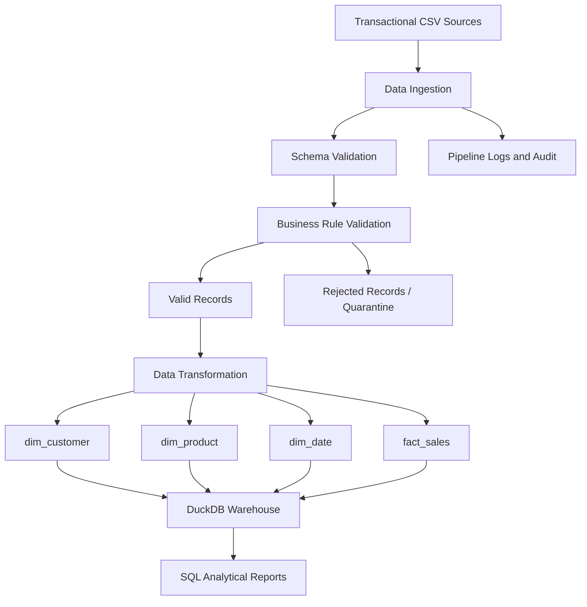

# E-Commerce Data Warehouse & ETL Pipeline

## 1. Project Overview

This project implements a small dimensional data warehouse for an e-commerce business using Python, Pandas, SQL and DuckDB.

The solution processes transactional CSV data, validates records, handles data-quality issues, transforms valid records into dimension and fact tables, and publishes the results into a DuckDB analytical warehouse.

The objective is to demonstrate an end-to-end data engineering workflow covering data ingestion, validation, transformation, dimensional modeling, data publishing, testing, performance measurement and documentation.

## 2. Business Problem

E-commerce businesses generate transactional data from customers, products, orders and order items.

Analyzing this data directly from transactional sources can make reporting difficult because information is distributed across multiple files and requires cleaning and transformation.

This project addresses the problem by building a centralized dimensional model that supports analytical questions such as:

- What is the total sales revenue?
- What is the monthly revenue?
- Which products generate the highest revenue?
- Which customers contribute the most sales?
- How does revenue vary across product categories and regions?

## 3. Project Objectives

- Build a dimensional data warehouse from transactional sources.
- Define source and target schemas.
- Implement data ingestion and validation.
- Identify and quarantine invalid records.
- Create dimension and fact tables.
- Maintain primary-key and foreign-key relationships.
- Implement safe fact-table reload behavior.
- Generate analytical reports using SQL.
- Test important data-quality scenarios.
- Measure performance using 100,000 synthetic records.

## 4. Technology Stack

| Technology | Purpose |
|---|---|
| Python | Pipeline implementation |
| Pandas | Data cleaning and transformation |
| NumPy | Numerical operations and data generation |
| Faker | Synthetic data generation |
| DuckDB | Analytical database |
| SQL | Analytical queries |
| Pytest | Automated testing |
| Jupyter Notebook | Development and execution |
| GitHub | Version control and project submission |

## 5. Project Architecture

The pipeline follows this architecture:



### Pipeline stages

1. Source data generation and ingestion.
2. Schema and data-quality validation.
3. Separation of valid and rejected records.
4. Transformation into dimensional tables.
5. Publishing data into DuckDB.
6. Analytical reporting using SQL.
7. Logging, testing and performance measurement.

## 6. Source Data

The project uses synthetic transactional datasets.

| Source file | Description |
|---|---|
| customers.csv | Customer information |
| products.csv | Product information |
| orders.csv | Customer order transactions |
| order_items.csv | Individual products within orders |

### Sample dataset

The initial sample contains approximately:

- 100 customers
- 30 products
- 500 orders
- 1,000 order items before deliberate invalid records are added

The data generator uses fixed random seeds to support reproducibility.

Additional invalid records are introduced to demonstrate data-quality validation.

## 7. Source Entities and Relationships

### Customers

- Primary key: customer_id
- Contains customer name, email, city and region.
- Customer identifiers must be unique.

### Products

- Primary key: product_id
- Contains product name, category and unit price.
- Product identifiers must be unique.

### Orders

- Primary key: order_id
- Foreign key: customer_id
- Contains order date and order status.
- Customer references must exist in the customer source.

### Order Items

- Primary key: order_item_id
- Foreign keys: order_id and product_id
- Contains quantity, unit price and discount.
- Quantity and price must be valid positive values.

## 8. Dimensional Data Model

The project follows a star-schema dimensional modeling approach.

### Dimension tables

**dim_customer**

Stores customer descriptive attributes.

Important columns:
- customer_key
- customer_id
- customer_name
- email
- city
- region

**dim_product**

Stores product descriptive attributes.

Important columns:
- product_key
- product_id
- product_name
- category
- unit_price

**dim_date**

Stores calendar information.

Important columns:
- date_key
- full_date
- day
- month
- month_name
- quarter
- year

### Fact table

**fact_sales**

Stores sales transactions at order-item level.

Important columns:
- order_item_id
- order_id
- customer_key
- product_key
- date_key
- quantity
- unit_price
- discount
- gross_amount
- sales_amount

### Fact table grain

One row represents one order item belonging to a completed order.

This grain supports analysis at product, customer and date levels.

## 9. Keys and Relationships

### Primary keys

- dim_customer.customer_key
- dim_product.product_key
- dim_date.date_key
- fact_sales.order_item_id

### Foreign keys

- fact_sales.customer_key references dim_customer.customer_key.
- fact_sales.product_key references dim_product.product_key.
- fact_sales.date_key references dim_date.date_key.

### Surrogate key strategy

Integer surrogate keys are generated for customer and product dimensions using sorted source identifiers.

Date keys use the YYYYMMDD integer format.

This provides deterministic keys for the static sample dataset. A persistent key-mapping strategy would be needed for production incremental loading when new source records arrive.

## 10. Measures and Business Calculations

The fact table contains the following measures:

- quantity
- unit_price
- discount
- gross_amount
- sales_amount

### Calculation rules

Gross amount:

quantity × unit_price

Sales amount:

gross_amount − discount

Only completed orders are included in the sales fact table.

Discounts must not be negative or greater than the gross amount.

## 11. Data Validation and Quality Checks

The pipeline implements validation rules to identify invalid records.

### Validation checks

- Missing required fields.
- Duplicate customer identifiers.
- Duplicate product identifiers.
- Duplicate order identifiers.
- Duplicate order-item identifiers.
- Invalid customer references.
- Invalid product references.
- Invalid order references.
- Invalid date values.
- Negative or missing quantities.
- Invalid or missing prices.
- Invalid discounts.

### Rejected records

Invalid records are separated into quarantine files for investigation.

The objective is to prevent invalid source records from silently entering the analytical warehouse.

## 12. Data Transformation

Pandas is used to transform validated transactional records.

Main transformation operations include:

1. Selecting valid completed orders.
2. Creating customer dimension records.
3. Creating product dimension records.
4. Generating date dimension records.
5. Joining order items with orders.
6. Mapping source identifiers to surrogate keys.
7. Calculating gross amount and sales amount.
8. Creating the final fact_sales dataset.

## 13. Data Warehouse Publishing

DuckDB is used as the local analytical database.

The warehouse contains:

- dim_customer
- dim_product
- dim_date
- fact_sales

The database is stored locally and supports analytical SQL queries without requiring a separate database server.

## 14. Analytical SQL Queries

The project supports analytical reporting using SQL.

Examples include:

### Total revenue

```sql
SELECT
    SUM(sales_amount) AS total_revenue
FROM fact_sales;
```

### Monthly revenue

```sql
SELECT
    d.year,
    d.month,
    d.month_name,
    SUM(f.sales_amount) AS monthly_revenue
FROM fact_sales f
JOIN dim_date d
    ON f.date_key = d.date_key
GROUP BY
    d.year,
    d.month,
    d.month_name
ORDER BY
    d.year,
    d.month;
```

### Top five products

```sql
SELECT
    p.product_name,
    SUM(f.quantity) AS units_sold,
    SUM(f.sales_amount) AS total_revenue
FROM fact_sales f
JOIN dim_product p
    ON f.product_key = p.product_key
GROUP BY p.product_name
ORDER BY total_revenue DESC
LIMIT 5;
```

### Top ten customers

```sql
SELECT
    c.customer_name,
    COUNT(DISTINCT f.order_id) AS total_orders,
    SUM(f.sales_amount) AS total_spent
FROM fact_sales f
JOIN dim_customer c
    ON f.customer_key = c.customer_key
GROUP BY c.customer_name
ORDER BY total_spent DESC
LIMIT 10;
```

## 15. Logging and Operational Monitoring

The project includes pipeline logging and run-level monitoring.

The monitoring design records:

- run_id
- start time
- end time
- input record count
- output record count
- rejected record count
- execution duration
- pipeline status
- failure reason

These metrics help identify pipeline failures and understand data-processing results.

## 16. Idempotency and Recovery

The project includes a fact-table reload verification.

The intended behavior is that reloading the same input should not increase the number of fact records.

A separate performance test uses an independent in-memory DuckDB connection to avoid interfering with the main warehouse connection.

Production improvements could include:
- Persistent run checkpoints.
- Atomic publishing.
- Automated retry handling.
- Incremental loading.
- Backfill support.
- Persistent audit history.

## 17. Automated Testing

Pytest is used to test important validation and pipeline behaviors.

Test scenarios include:

- Happy path.
- Empty input.
- Missing required columns.
- Duplicate records.
- Null values.
- Invalid foreign keys.
- Negative quantities.
- Late-arriving records.
- Deterministic processing.
- Failure scenarios.

Run the tests using:

```bash
python -m pytest -v tests
```

Test results should be checked in the local environment before submission.

## 18. Performance Testing

A configurable synthetic dataset containing 100,000 order-item records is used for performance testing.

The performance test measures:

- Data generation time.
- Transformation time.
- DuckDB loading time.
- Total execution time.
- Records processed per second.
- DataFrame memory usage.

### Optimization approach

Vectorized Pandas operations are used for data transformation rather than relying entirely on row-by-row processing.

The measured results are saved in:

`output/performance_report.csv`

Actual performance measurements depend on the execution environment.

## 19. Project Structure

```text
ecommerce-data-warehouse/
│
├── ecommerce_data_warehouse.ipynb
├── README.md
├── requirements.txt
├── .gitignore
├── data_dictionary.csv
├── prompt_history.md
├── AI_USAGE.md
│
├── data/
│   ├── customers.csv
│   ├── products.csv
│   ├── orders.csv
│   ├── order_items.csv
│   └── quarantine/
│
├── output/
│   ├── dim_customer.csv
│   ├── dim_product.csv
│   ├── dim_date.csv
│   ├── fact_sales.csv
│   └── performance_report.csv
│
├── src/
│   └── validation.py
│
├── tests/
│   └── test_pipeline.py
│
├── sql/
│   ├── sales_analysis.sql
│   ├── monthly_revenue.sql
│   ├── top_products.sql
│   └── customer_analysis.sql
│
└── logs/
```

## 20. Installation and Setup

### Prerequisites

- Python 3.10 or later.
- Jupyter Notebook.
- Required Python packages.

### Step 1: Clone the repository

```bash
git clone https://github.com/k-shiva248/ecommerce-data-warehouse.git
```

### Step 2: Open the project folder

```bash
cd ecommerce-data-warehouse
```

### Step 3: Install dependencies

```bash
pip install -r requirements.txt
```

### Step 4: Launch Jupyter Notebook

```bash
jupyter notebook
```

### Step 5: Execute the project

Open:

`ecommerce_data_warehouse.ipynb`

Run the notebook cells in sequence to execute the data engineering workflow.

### Step 6: Run automated tests

```bash
python -m pytest -v tests
```

## 21. Reconciliation and Verification

The following checks should be performed to verify output correctness:

- Verify primary-key uniqueness.
- Verify foreign-key integrity.
- Compare eligible source order-item counts with fact-table counts.
- Compare calculated sales amounts with fact-table sales amounts.
- Verify dimension and fact record counts.
- Verify rejected-record counts.
- Verify repeated loading does not introduce duplicate fact records.

Differences between raw source counts and fact counts should be explained by documented validation rules and the completed-order filter.

## 22. Design Decisions and Trade-offs

### Why DuckDB?

DuckDB is lightweight, locally runnable and suitable for analytical SQL workloads. It avoids the need to configure an external database server.

### Why a star schema?

The star schema simplifies analytical joins and provides a clear separation between descriptive dimensions and measurable business events.

### Why order-item grain?

Order-item grain allows sales to be analyzed at product, customer and date levels without losing individual transaction detail.

### Why Pandas?

Pandas provides convenient data manipulation, validation and vectorized transformation capabilities for this project.

### Trade-offs

- Static surrogate key assignment is suitable for the reproducible sample but needs persistent mappings in a production environment.
- Full incremental loading is not implemented.
- Full Slowly Changing Dimension Type 2 processing is not implemented.
- Recovery and retry behavior can be strengthened.
- The project uses local CSV files and DuckDB rather than a cloud-based architecture.

## 23. Limitations and Future Improvements

Potential improvements include:

1. Implement incremental loading with watermarks.
2. Add Slowly Changing Dimension Type 2.
3. Improve late-arriving data handling.
4. Implement robust transaction recovery and retry mechanisms.
5. Improve source-to-target audit reconciliation.
6. Add configurable source and target paths.
7. Introduce automated pipeline scheduling.
8. Extend the solution to cloud storage and orchestration.

## 24. AI Usage Disclosure

AI assistance was used during project planning, implementation guidance, debugging, testing guidance and documentation.

The project includes:

- `prompt_history.md` – record of prompts used during development.
- `AI_USAGE.md` – explanation of AI assistance and personal review.

The implementation, assumptions, code behavior and limitations should be understood and explained by the project author.

## 25. Conclusion

This project demonstrates an end-to-end local data engineering workflow for transforming transactional e-commerce data into a dimensional analytical warehouse.

It covers data ingestion, validation, transformation, dimensional modeling, analytical SQL, testing, performance measurement and operational considerations.

The solution provides a foundation for further development into a production-grade data engineering pipeline.

## 26. Author and Repository

**Project:** E-Commerce Data Warehouse & ETL Pipeline

**GitHub Repository:**

https://github.com/k-shiva248/ecommerce-data-warehouse

**Technologies:** Python | Pandas | NumPy | DuckDB | SQL | Pytest | Jupyter Notebook

